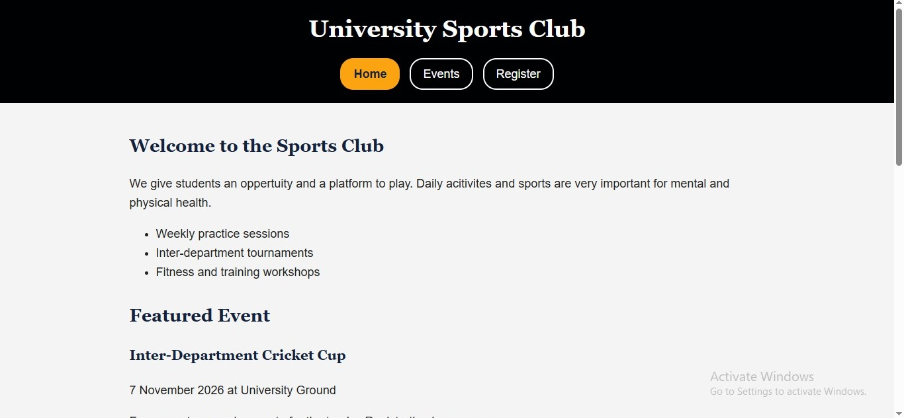

# University Sports Club Website

Live site: https://cit331-assignment1-0007.vercel.app/
Github Link : https://github.com/taqiitmaster/cit331-assignment1-0007

# Description 
This is a 3 page website that i have created as a assignment in my university. There are 3 html files 1 css file and one js file in this. Js is used to save the regestrations of the participants.

# Pages
Home
Events
Regester

# Locally
1. Download or clone this repository.
2. Open the folder.
3. Double-click `index.html` to open it in your browser.

# Home Page Secreen Shot

# Image Details
source : scholarbasketball.com
image link : https://scholarbasketball.com/wp-content/uploads/2024/11/Top-Warm-Up-Routines-for-Basketball-Players.png 